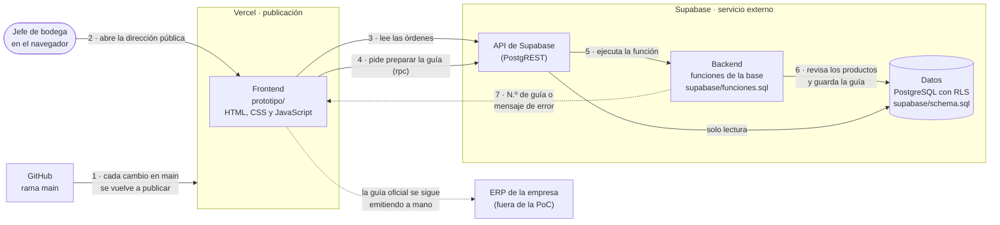

# Arquitectura y PoC · Automatizacion_bodega

Grupo 6 · Avance 7

Este documento muestra de qué piezas está hecha la prueba de concepto (PoC) y cuál es la acción que recorre todas esas piezas de punta a punta. El detalle de las reglas por campo, todos los mensajes de error y las pruebas de rotura está en [docs/poc-supabase.md](poc-supabase.md).

## Diagrama de componentes

| Pieza | Qué hace en nuestra solución | Con qué está hecha | Con quién se comunica |
|---|---|---|---|
| Frontend | Muestra las cuatro pantallas del prototipo (cargar pedido, validar, registrar cambio y guía lista). En el camino delgado, muestra el botón **Preparar guía**, lo bloquea si hay productos con problema y después muestra el número de la guía o el mensaje de error, sin borrar lo que la persona hizo | HTML, CSS y JavaScript sin compilar, en `prototipo/` (`app.js`, `api.js`, `reglas.js`) | Con la API de Supabase, mediante la librería `supabase-js`. La dirección y la clave publicable se las entrega Vercel al publicar |
| Backend | Vuelve a revisar todo antes de guardar, sin confiar en lo que diga la pantalla. Para preparar la guía comprueba que la orden exista y no tenga guía, que quien la prepara sea el jefe de bodega, que todos los productos vigentes estén validados y que el inventario los siga mostrando disponibles. Si algo no cumple, no guarda nada y devuelve el mensaje exacto | Cinco funciones de PostgreSQL en `supabase/funciones.sql`. La del camino delgado es `preparar_guia` | La llama el frontend a través de la API. Lee y escribe en las tablas |
| Datos | Guarda las órdenes 3001 y 3002, sus productos, el inventario de ejemplo, los cambios y las guías preparadas. Las restricciones de las tablas son la última barrera, por ejemplo una orden no puede tener dos guías | Supabase (PostgreSQL) con RLS, en `supabase/schema.sql`, `acceso.sql` y `seed_poc.sql` | El navegador solo puede leerla. Escribir solo se puede a través de las funciones |
| Servicio externo | Supabase aloja el backend y los datos. No lo controlamos nosotros, así que si no responde la PoC no puede guardar | Supabase, plan gratis | Con el frontend, por internet |
| Publicación | Entrega el sitio en una dirección pública que se abre sin iniciar sesión. Al construir, genera `prototipo/js/config.js` con las variables de entorno, para que ninguna clave quede escrita en el repositorio | Vercel, conectado a la rama `main` de GitHub | Con GitHub, que le avisa cada cambio en `main`, y con el navegador de la persona |

**Plan de falla del servicio externo.** Si Supabase no responde o tarda más de 10 segundos, la pantalla muestra *"No hay conexión con la base de datos. Lo que escribiste sigue aquí. Revisa tu internet y vuelve a intentar."*, deja el botón activo para reintentar y no guarda nada a medias. Si el fallo es interno de la base, muestra *"No se pudo completar por un problema del sistema…"*, sin códigos técnicos. Mientras Supabase no vuelva, la persona sigue preparando la guía como hoy, a mano en el ERP, así que la bodega no se detiene. El ERP no está conectado a la PoC, por eso no tiene plan de falla propio.

**Dónde está el código.** El código de la PoC está en `prototipo/` (frontend) y en `supabase/` (backend y datos). La carpeta `src/` guarda la aplicación Streamlit de los avances anteriores, que la profesora pidió congelar en la retroalimentación del Avance 5. Decidimos no mover el código el día antes de la entrega para no romper la publicación en Vercel.

## Camino delgado

**Acción.** Preparar la guía de una orden. La persona presiona **Preparar guía** en una orden ya cargada y validada, y recibe el número interno de la guía.

**Por qué es lo más frágil.** Todo el proyecto descansa en una promesa, que una guía nunca sale con un código mal escrito o con un equipo que no está disponible. Hoy ese error se descubre tarde y obliga a rehacer la guía. Si esta revisión fallara, o si solo la hiciera la pantalla, el sistema repetiría el mismo error que el papel, pero más rápido. Por eso es lo primero que tenía que funcionar con piezas reales, y la comprobación la hace la base de datos, no el formulario.

**Cómo se recorre.**

| Paso | Qué pasa | Pieza |
|---|---|---|
| Entrada en pantalla | En la orden 3001, la persona presiona **Preparar guía** | Frontend |
| Validación en el backend | `preparar_guia` vuelve a revisar los cuatro productos contra el inventario, aunque la pantalla ya los haya marcado como validados | Backend |
| Registro guardado | Se crea una fila en la tabla `guias` con el número interno y la fecha | Datos |
| Respuesta visible | La pantalla de guía lista muestra el **N.º interno** de la guía | Frontend |

**Caso de error.** En la orden 3002, uno de los productos es `SD-63A20-9999`, un código que no existe en el inventario. La guía queda bloqueada y aparece *"Corrige 1 producto para continuar."* Aunque alguien se salte la pantalla y llame directo a la función, la base responde lo mismo y no guarda la guía. También se rechaza si quien prepara la guía no es el jefe de bodega (*"Solo el jefe de bodega puede preparar la guía."*) o si la orden ya tiene una guía.

**Queda fuera por ahora (decisión, no olvido).**
- Emitir la guía oficial en el ERP. La guía de la PoC es un número interno y la oficial se sigue haciendo en el ERP, porque la integración está fuera del alcance del MVP.
- Inicio de sesión y permisos por cargo. Quién prepara la guía se elige en la pantalla y la base no puede comprobar que sea cierto. Es parte del Avance 8.
- Actualizar el estado y la ubicación de los equipos al preparar la guía. Se dejó fuera para poder repetir la demostración con **Reiniciar demo**.
- Cargar el pedido desde un archivo. Por ahora se pega la lista de códigos.
- Datos reales. Todo lo que guarda la PoC es de ejemplo e inventado.
- Las otras acciones de la PoC (cargar el pedido, validar y registrar un cambio) también usan la base, pero no son el camino delgado. Están documentadas en `docs/poc-supabase.md`.

**Si algo falla, la persona** ve el mensaje junto al campo o arriba de la pantalla, lo que hizo sigue ahí y puede corregir y volver a intentar. Si el problema es de conexión, lo dice así y le pide reintentar. Nunca queda una guía guardada a medias.

## Evidencia

**Dirección pública.** [bodega-poc.vercel.app](https://bodega-poc.vercel.app), publicada desde `main`. Debe abrirse sin iniciar sesión, y se revisa en una ventana de incógnito antes de la entrega.

**Video (2 min 44 s).** [Ver el video en Google Drive](https://drive.google.com/file/d/1B3kULAPBZwG80R2dx-YSNuFwBkI--41n/view?usp=sharing). Recorre el caso exitoso (orden 3001), la guía que sigue guardada después de recargar la página y el caso de error (orden 3002).

**Caso de error probado.** Orden 3002 con `SD-63A20-9999`, guía bloqueada con *"Corrige 1 producto para continuar."* Además, en `supabase/probar_en_supabase.py` se llama a `preparar_guia` sin pasar por la pantalla, con productos sin validar, con un código que no existe y con un usuario que no es jefe de bodega, y la base rechaza los tres sin crear la guía (ver la sección 3 de `docs/poc-supabase.md`).
