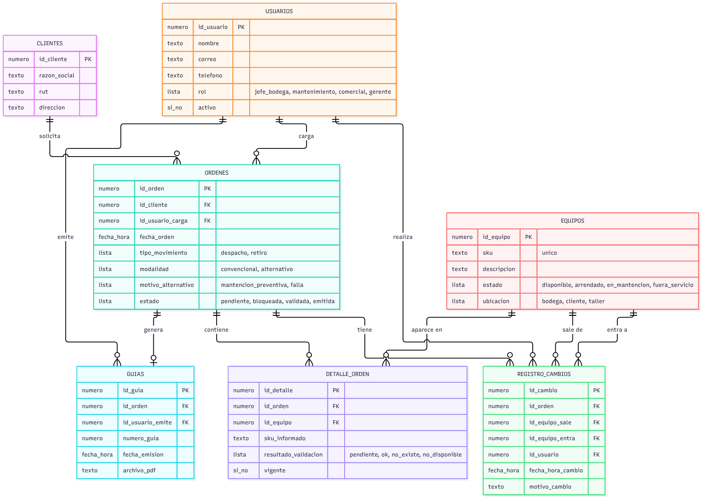
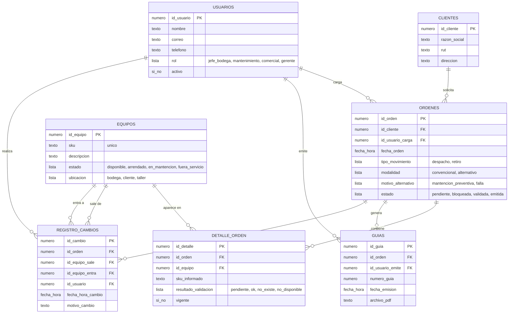

# Estructura de datos preliminar

Grupo 6 · Automatizacion_bodega · Versión del 2026-10-04 (Avance 3), actualizada el 2026-10-15 y el 2026-11-01 (correcciones de la revisión del Avance 3)

Las tablas salen de los sustantivos del caso de uso del Avance 2 (emisión automática de guía): cliente, usuario, orden, equipo, detalle de orden, guía y cambio de último minuto. Este es el diseño preliminar; todavía no se crea la base en Supabase.

> El MVP actual usa SQLite con tres tablas (`inventario`, `ordenes`, `log_cambios`), definidas en `src/app.py`. Este modelo es el objetivo: separa la orden de su detalle, agrega `CLIENTES`, `USUARIOS` y `GUIAS`, y reemplaza `log_cambios` por `REGISTRO_CAMBIOS`.

## 1. Diagrama de la base de datos

Mismo diagrama en Mermaid, que GitHub dibuja automáticamente:

Cada tabla muestra sus campos con su tipo (texto, número, fecha y hora, sí o no, lista), su clave primaria (PK) y sus claves externas (FK).

## 2. Relaciones y cardinalidad

Las claves externas siempre van en el lado "muchos" de la relación.

| Relación | Cardinalidad | Se lee |
|---|---|---|
| CLIENTES → ORDENES | 1 : N | un cliente tiene muchas órdenes; cada orden es de un solo cliente |
| USUARIOS → ORDENES | 1 : N | un usuario carga muchas órdenes |
| ORDENES → DETALLE_ORDEN | 1 : N | una orden tiene muchos productos (hasta 60, el máximo que acepta el ERP), uno por fila |
| EQUIPOS → DETALLE_ORDEN | 1 : N | un equipo aparece en muchas órdenes a lo largo del tiempo |
| ORDENES → GUIAS | 1 : 1 | una orden genera una sola guía (ninguna mientras está bloqueada) |
| USUARIOS → GUIAS | 1 : N | un jefe de bodega emite muchas guías |
| ORDENES → REGISTRO_CAMBIOS | 1 : N | una orden puede tener varios cambios de último minuto |
| EQUIPOS → REGISTRO_CAMBIOS | 1 : N (dos veces) | un equipo puede salir de muchos cambios y entrar en muchos |
| USUARIOS → REGISTRO_CAMBIOS | 1 : N | cada cambio queda firmado por quien lo hizo |

## 3. Decisiones de diseño

- **Un SKU por fila en DETALLE_ORDEN.** Nunca se escriben varios SKU en una sola celda separados por comas.
- **Claves externas en vez de nombres.** La orden guarda `id_cliente`, no el nombre del cliente.
- **SKU_INFORMADO** guarda el SKU tal como llegó en el listado. Si no existe en EQUIPOS, `id_equipo` queda vacío, la validación marca `no_existe` y la orden pasa a `bloqueada`, que es la extensión del caso de uso.
- **VIGENTE** conserva el historial: cuando un equipo se cambia a último minuto, la línea antigua no se borra, sino que queda `vigente = no` y se agrega la nueva. La guía sólo usa las líneas vigentes.
- **MODALIDAD Y MOTIVO_ALTERNATIVO.** Según la conversación con el subjefe de bodega (pregunta D1), un despacho o un retiro puede ser `convencional` (el movimiento normal) o `alternativo` (el cambio de un equipo por mantención o por falla). Por eso `modalidad` es obligatoria en toda orden, y `motivo_alternativo` (`mantencion_preventiva` o `falla`) es obligatorio **solo** cuando `modalidad = alternativo`; en una orden convencional queda vacío, en lugar de llevar un valor de relleno.
- **MOTIVO_CAMBIO es obligatorio.** Un cambio de último minuto sin motivo no sirve como respaldo cuando la gente sale tarde (conversación, preguntas 12 y 13). La regla la pone el negocio, y los ejemplos se ajustan a ella. El prototipo todavía ofrece "Sin motivo"; corregirlo es el riesgo 3 de `docs/etica.md`.
- **La ubicación del equipo se actualiza con cada guía.** Al emitir un despacho, el equipo pasa a `arrendado` en `cliente`; al emitir un retiro, vuelve como `en_mantencion` en `taller`, porque mantenimiento lo revisa antes de volver a arrendarlo (conversación, pregunta 3).
- Los accesorios genéricos sin SKU (ductos, transiciones), que se cortan o se dañan en terreno, quedan fuera de este diseño preliminar y se incorporarán en la siguiente versión del modelo.

## 4. Campos obligatorios y ejemplos

Los campos marcados con `*` son obligatorios (no pueden quedar vacíos); los demás pueden quedar vacíos. Los ejemplos cuentan **una misma mañana de bodega**, así que cada clave externa apunta a un registro que existe en su tabla:

- **Orden 3001** (despacho convencional): se cargó con el equipo 503, que estaba en mantención; a las 09:55 mantenimiento lo cambió por el 502, y a las 10:02 se emitió la guía 70. Los equipos 501 y 502 quedaron en el cliente.
- **Orden 3002** (retiro alternativo por falla): trae el SKU `SD-63A20-9999`, que no existe, así que quedó bloqueada y no tiene guía.
- **Orden 3003** (retiro convencional): el pedido traía un código mal digitado (507); a las 11:10 el jefe de bodega lo cambió por el 505, que es el que volvía, y a las 11:30 se emitió la guía 71. El 505 quedó en el taller para su mantención.

Los SKU de las extensiones siguen el formato real de la empresa: en `SD-63A20-0314`, `SD` indica extensión, `63A` el amperaje, `20` los metros y `0314` el número de la unidad. Los demás datos son ilustrativos.

**USUARIOS**

| id_usuario* | nombre* | correo* | telefono | rol* | activo* |
|---|---|---|---|---|---|
| 1 | Pedro Soto | psoto@ejemplo.cl | +56 9 1111 1111 | jefe_bodega | sí |
| 2 | Camila Rojas | crojas@ejemplo.cl | +56 9 2222 2222 | mantenimiento | sí |

**CLIENTES**

| id_cliente* | razon_social* | rut* | direccion* |
|---|---|---|---|
| 10 | Constructora Andes SpA | 76.123.456-7 | Av. Matta 1200, Santiago |
| 11 | Minera Cordillera S.A. | 77.987.654-3 | Camino a Farellones km 12, Lo Barnechea |

**EQUIPOS** (estado y ubicación al final de la mañana)

| id_equipo* | sku* | descripcion* | estado* | ubicacion* |
|---|---|---|---|---|
| 501 | SD-63A20-0314 | Extensión 63 A x 20 m | arrendado | cliente |
| 502 | SD-63A20-0315 | Extensión 63 A x 20 m | arrendado | cliente |
| 503 | SD-63A20-0316 | Extensión 63 A x 20 m | en_mantencion | taller |
| 504 | SD-32A10-0102 | Extensión 32 A x 10 m | arrendado | cliente |
| 505 | SD-32A10-0108 | Extensión 32 A x 10 m | en_mantencion | taller |
| 507 | MP-0107 | Manga perforada | disponible | bodega |

El 504 sigue en el cliente porque su retiro (orden 3002) está bloqueado. El 507 nunca salió de bodega: solo estaba mal digitado en la orden 3003.

**ORDENES**

| id_orden* | id_cliente* | id_usuario_carga* | fecha_orden* | tipo_movimiento* | modalidad* | motivo_alternativo (* si es alternativo) | estado* |
|---|---|---|---|---|---|---|---|
| 3001 | 10 | 1 | 2026-10-05 08:15 | despacho | convencional | (vacío) | emitida |
| 3002 | 11 | 1 | 2026-10-05 09:40 | retiro | alternativo | falla | bloqueada |
| 3003 | 10 | 1 | 2026-10-05 10:30 | retiro | convencional | (vacío) | emitida |

**DETALLE_ORDEN**

| id_detalle* | id_orden* | id_equipo | sku_informado* | resultado_validacion* | vigente* |
|---|---|---|---|---|---|
| 9001 | 3001 | 501 | SD-63A20-0314 | ok | sí |
| 9002 | 3001 | 503 | SD-63A20-0316 | no_disponible | no |
| 9003 | 3001 | 502 | SD-63A20-0315 | ok | sí |
| 9004 | 3002 | 504 | SD-32A10-0102 | ok | sí |
| 9005 | 3002 | (vacío) | SD-63A20-9999 | no_existe | sí |
| 9006 | 3003 | 507 | MP-0107 | ok | no |
| 9007 | 3003 | 505 | SD-32A10-0108 | ok | sí |

Las líneas 9002 y 9006 quedaron `vigente = no` por los cambios de último minuto; no se borran. La 9005 sigue vigente y bloquea la orden 3002 hasta que se corrija.

**GUIAS**

| id_guia* | id_orden* | id_usuario_emite* | numero_guia* | fecha_emision* | archivo_pdf |
|---|---|---|---|---|---|
| 70 | 3001 | 1 | 15230 | 2026-10-05 10:02 | guia_15230.pdf |
| 71 | 3003 | 1 | 15231 | 2026-10-05 11:30 | (vacío) |

La orden 3002 no tiene guía porque está bloqueada.

**REGISTRO_CAMBIOS**

| id_cambio* | id_orden* | id_equipo_sale* | id_equipo_entra* | id_usuario* | fecha_hora_cambio* | motivo_cambio* |
|---|---|---|---|---|---|---|
| 1 | 3001 | 503 | 502 | 2 | 2026-10-05 09:55 | Equipo en mantención |
| 2 | 3003 | 507 | 505 | 1 | 2026-10-05 11:10 | Código mal digitado en el pedido |

Cada cambio ocurre antes de la guía de su orden, y los equipos que salen y entran corresponden a las líneas 9002 → 9003 y 9006 → 9007 de DETALLE_ORDEN.

## 5. Pendientes del modelo

Tres ajustes posibles al modelo. Son **hipótesis**: salieron de un ensayo con personajes ficticios y se confirmarán o descartarán con las conversaciones con bodega (la primera, del 10 de octubre, está en `docs/entrevistas/`). No cambian las tablas ni el diagrama de este documento.

1. **Accesorios sin SKU (hipótesis).** Los ductos y las transiciones no tienen código y hoy quedan fuera del modelo (ver "Decisiones de diseño"). La idea es registrarlos por tipo y cantidad, aparte de los SKU. La conversación del 10 de octubre confirmó que hoy se anotan en el ERP como «genérico» con una descripción escrita a mano, y que son los que más alargan la guía (preguntas 7 y 9). Queda en el roadmap, columna "Después".
2. **Estados del equipo (hipótesis).** El diagrama propone para `estado` los valores disponible, arrendado, en_mantencion y fuera_servicio; el MVP actual solo distingue el stock disponible como número. Por confirmar: cuáles estados existen en la práctica y quién los actualiza.
3. **Adjunto de foto de la carga (hipótesis).** Guardar una foto asociada a la orden como respaldo del despacho. Hoy no hay ningún campo para esto. Por confirmar: si la foto es parte del proceso y dónde se guardaría.
