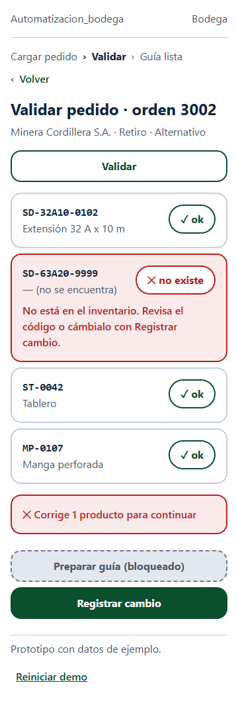
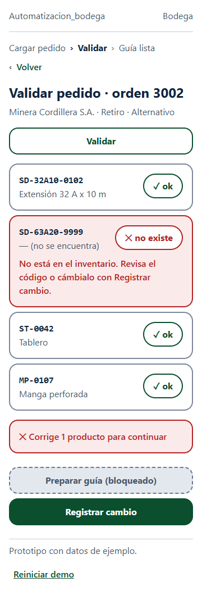

# Análisis ético del prototipo · Automatizacion_bodega

Grupo 6 · Avance 5, Parte B

El análisis se hace sobre el prototipo publicado en [bodega-prototipo.vercel.app](https://bodega-prototipo.vercel.app) (detalle en [docs/prototipo.md](prototipo.md)), con lo que contó el subjefe de bodega en la [conversación del Avance 4](entrevistas/entrevista_subjefe_bodega.md) y con los campos de [docs/datos/estructura_datos.md](datos/estructura_datos.md).

## B1 · Mapa de impacto y exclusión

| Actor | Qué tarea deja de hacer | Cómo se redefine su rol | Riesgo si nadie se hace cargo |
|---|---|---|---|
| **Quien ejecuta:** jefe o subjefe de bodega, que hoy arma la guía en el ERP | Deja de digitar los SKU uno a uno y de confirmar los cambios por llamada o WhatsApp (entrevista, preguntas 1, 11 y 13) | Valida el pedido en P2, corrige solo las líneas en rojo y deja la guía lista para pasarla al ERP (P4). Pasa de digitar a revisar | Confiar en el "✓ ok" aunque el inventario no esté al día: hoy la planilla se actualiza a mano y, en temporada alta, solo los sábados (pregunta 5). Un "ok" falso despacha un equipo que no está |
| **Quien decide:** gerente de administración, que recibe los reportes de guías anuladas (pregunta 10) | Deja de enterarse de los errores por correos de atraso o por guías anuladas en el SII | Revisa el historial de cambios (quién, qué equipo, a qué hora) y decide sobre el procedimiento con datos | Usar el registro de "Quién lo registra" (P3) para buscar culpables. Si pasa, las áreas dejan de registrar y vuelven al WhatsApp, y el historial queda vacío |
| **Quien queda excluido:** bodeguero de terreno, cercano a la tercera edad, sin cuenta en el sistema y que anota en papel lo que sale y lo que vuelve en los retiros (preguntas 3, 14 y 15) | Nunca usa el prototipo: el selector "Quién lo registra" de P3 solo ofrece usuarios con cuenta, y la carga de P1 la hace el jefe de bodega | Sigue anotando en papel y entrega sus notas al jefe de bodega, que las transcribe | Lo que él cuenta (un equipo que no volvió, un accesorio genérico cortado en terreno) no existe en el dato hasta que alguien lo transcribe, y ahí reaparece el error humano que la solución quería eliminar |

También queda fuera, en menor grado, el **técnico de mantenimiento que avisa el cambio por llamada desde el taller, sin computador**: si no registra el cambio en P3, la guía puede salir "ok" con un equipo que no va a salir.

## B2 · Ficha de tratamiento de datos personales

Una fila por cada campo del formulario del prototipo (P1 y P3) y por los datos que el sistema agrega solo. Ningún campo pide RUT, teléfono, correo ni dirección de una persona: el único dato personal es el **nombre de quien registra o prepara**.

| Campo del prototipo | Campo en `estructura_datos.md` | ¿Dato personal? | Finalidad (historia) | Quién accede | Cuánto se conserva |
|---|---|---|---|---|---|
| Orden (P1) | `ORDENES.id_orden` | No | HU-02: elegir el pedido que se carga | Jefe y subjefe de bodega | Mientras exista la guía asociada |
| Cliente (P1, solo lectura) | `ORDENES.id_cliente` → `CLIENTES.razon_social` | No (empresa) | HU-02 y HU-05: la guía debe ir al cliente correcto | Jefe y subjefe de bodega, comercial | Mientras exista la guía asociada |
| Tipo de movimiento (P1) | `ORDENES.tipo_movimiento` | No | HU-02: distinguir despacho de retiro | Jefe y subjefe de bodega | Mientras exista la guía asociada |
| Modalidad (P1) | `ORDENES.modalidad` | No | HU-02: distinguir convencional de alternativo (cambio por mantención o falla) | Jefe y subjefe de bodega | Mientras exista la guía asociada |
| Productos del pedido (P1) | `DETALLE_ORDEN.sku_informado` | No | HU-01 y HU-02: validar cada SKU contra el inventario | Jefe y subjefe de bodega | Mientras exista la guía asociada |
| Equipo que sale (P3) | `REGISTRO_CAMBIOS.id_equipo_sale` | No | HU-03 y HU-04: saber qué equipo se reemplazó | Jefe y subjefe de bodega, mantenimiento | Igual que el historial de la orden |
| Equipo que entra (P3) | `REGISTRO_CAMBIOS.id_equipo_entra` | No | HU-03 y HU-04: saber qué equipo lo reemplaza | Jefe y subjefe de bodega, mantenimiento | Igual que el historial de la orden |
| Motivo (P3) | `REGISTRO_CAMBIOS.motivo_cambio` | No | HU-04: tener respaldo cuando la gente sale más tarde de lo esperado | Jefe y subjefe de bodega, gerente de administración | Igual que el historial de la orden |
| **Quién lo registra (P3)** | `REGISTRO_CAMBIOS.id_usuario` → `USUARIOS.nombre` | **Sí** | HU-04: mostrar "Cambiado por X a las HH:MM" | Jefe y subjefe de bodega, gerente de administración. **No** se publica a todo el personal | Igual que el historial de la orden; se usa para reconstruir un error, no para evaluar a personas |
| Fecha y hora del cambio (automática) | `REGISTRO_CAMBIOS.fecha_hora_cambio` | Asociado a una persona | HU-04: saber a qué hora fue el cambio | Igual que "Quién lo registra" | Igual que el historial de la orden |
| **Quién prepara la guía (P4, automático)** | `GUIAS.id_usuario_emite` → `USUARIOS.nombre` | **Sí** | HU-05: responsable de la guía antes de pasarla al ERP | Jefe y subjefe de bodega, gerente de administración | Mientras exista la guía asociada |

**Plazo de conservación:** la guía oficial se emite en el ERP y se sube al SII (conversación, preguntas 1 y D5), así que su respaldo tributario queda en el ERP. El plazo exacto para los datos de este sistema es una **propuesta del equipo por confirmar con administración**.

**Campos revisados por privacidad desde el diseño:** el prototipo **no** incluye `USUARIOS.correo` ni un teléfono, aunque el modelo de datos los considera, porque ninguna pantalla del flujo principal los necesita. Se usarán solo si se agrega inicio de sesión. Tampoco se pide el motivo de una orden alternativa (`ORDENES.motivo_alternativo`), porque ninguna historia del flujo principal lo justifica.

## B3 · Sesgo, accesibilidad y transparencia

### Accesibilidad de las pantallas del prototipo

Los valores de contraste los midió el equipo con la fórmula de WCAG 2.x sobre `prototipo/css/estilos.css` (detalle en [docs/prototipo.md](prototipo.md#contrastes-medidos)).

| Aspecto | Dónde se revisó | ¿Cumple? | Evidencia |
|---|---|---|---|
| Contraste entre texto y fondo (mínimo 4,5:1) | P1 a P4, en celular 360 × 800 y en escritorio | **Cumple** | El par más bajo es rojo sobre rosado, 5,63:1 (resumen "Corrige N productos") |
| Contraste de bordes de controles (mínimo 3:1) | Campos, botones y tarjetas de producto | **Cumple, salvo uno** | El borde del campo **Cliente** (solo lectura) en P1 mide 1,59:1 sobre blanco, y aún menos sobre su fondo gris. Queda pendiente (ver riesgos) |
| Elementos interactivos de al menos 24 × 24 px | Todos los botones, selectores y "‹ Volver" | **Cumple** | Todos miden al menos 44 × 44 px |
| Estados con texto y no solo con color | P2 y P4 | **Cumple** | Cada estado lleva texto e ícono: "✓ ok", "✕ no existe", "✕ sin stock", "Pendiente", "Preparar guía (bloqueado)" |
| Etiquetas visibles | Formularios de P1 y P3 | **Cumple** | Cada campo tiene su etiqueta encima: "Orden", "Productos del pedido, uno por línea", "Equipo que sale", "Quién lo registra"… |

### Ordenamiento o priorización

**No aplica.** El prototipo no ordena ni prioriza pedidos, personas ni turnos: muestra una orden a la vez, con sus productos en el mismo orden en que vienen del pedido de venta.

### Inteligencia artificial

**No aplica.** Ninguna pantalla sugiere ni decide con IA: la validación es una regla fija (el SKU existe en el inventario y está disponible, o no). La decisión final de preparar la guía la toma siempre el jefe o subjefe de bodega.

### Sesgo

El registro de "Quién lo registra" identifica a una persona por nombre. Si se usa para sancionar, perjudica justamente a quien sí registra los cambios, y favorece a quien sigue avisando por WhatsApp sin dejar huella. Por eso el historial solo lo ven el jefe y subjefe de bodega y el gerente de administración, y su finalidad declarada es reconstruir un error (B2).

## B4 · Sostenibilidad y riesgos

### Prácticas de uso eficiente de recursos

1. **Desactivar los despliegues de prueba en Vercel** y dejar solo el enlace de producción. Hoy existe un despliegue de prueba (`bodega-prototipo-hukcxcmdn-…vercel.app`) que además pide iniciar sesión.
2. **Comprimir las capturas** de `docs/capturas/` y `docs/img/etica/`, y no subir el mismo estado en dos tamaños cuando basta con uno.
3. **Consultar solo los datos que la pantalla usa:** P4 muestra solo las líneas con `vigente = sí`, y en la versión con base de datos se consultará solo la orden abierta, no todo el inventario.

### Riesgos

| # | Riesgo | Tratamiento | Responsable | Cuándo se revisa |
|---|---|---|---|---|
| 1 | El bodeguero de terreno sin cuenta queda fuera del dato (B1) | **Mitigar:** el jefe o subjefe de bodega registra el cambio por él y el sistema muestra quién lo transcribió | Oscar Ynchaustegui | Prueba con usuarios (Semana 7) |
| 2 | El registro por nombre se usa para culpar y la gente vuelve al WhatsApp | **Mitigar:** el historial solo lo ven jefe de bodega y administración, y su uso se acuerda con la gerencia | Oscar Ynchaustegui | Antes de probar con usuarios reales |
| 3 | El "Motivo" del cambio es opcional ("Sin motivo") y un cambio sin motivo no sirve como respaldo | **Mitigar:** hacer obligatorio el motivo en la siguiente versión del prototipo y del modelo de datos | Bastián Vargas (prototipo) y Diego Neves (modelo de datos) | Próximo avance |
| 4 | El inventario de ejemplo está siempre al día, pero el real se actualiza a mano; un "✓ ok" puede ser falso | **Aceptar** en el prototipo, porque usa datos de ejemplo; en la versión real se mostrará la fecha de la última actualización del inventario | Sebastián Carmona (validador y pruebas) | Al conectar la base real |
| 5 | El borde del campo Cliente (solo lectura) en P1 mide 1,59:1, bajo el mínimo de 3:1 | **Mitigar:** cambiarlo al mismo gris de las tarjetas (`#7A8799`) | Bastián Vargas | Antes de la prueba con usuarios (Semana 7) |

## Modificación del prototipo motivada por el análisis

**Hallazgo:** en la revisión de accesibilidad (B3), el borde de las tarjetas de producto de P2 medía **1,59:1** (`#C5CED9` sobre blanco), bajo el mínimo de 3:1. Con la luz de bodega y la vista cansada de quienes usan el flujo, las tarjetas se confundían con el fondo. **Cambio:** el borde pasó a `#7A8799`, que mide **3,65:1**.

| Antes | Después |
|---|---|
|  |  |

Capturas de la orden 3001 y en escritorio: [antes](img/etica/antes-p2-3001-1280.png) · [después](img/etica/despues-p2-3001-1280.png).
