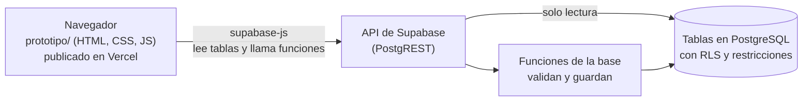

# Prueba de concepto con Supabase

Grupo 6 · Automatizacion_bodega

La prueba de concepto lleva el prototipo navegable a una base de datos real, solo en lo mínimo: leer las órdenes, validar los SKU, registrar un cambio y preparar la guía. No es la aplicación final y no cambia lo que se va a probar con usuarios (`docs/prueba-usuarios.md`): las órdenes 3001 y 3002 quedan igual que en el prototipo.

> **Estado de las pruebas (14 de noviembre de 2026).**
>
> - **Se probó en Supabase.** Los cuatro scripts (`schema.sql`, `acceso.sql`, `funciones.sql` y `seed_poc.sql`) se ejecutaron en el proyecto sin error y los conteos coincidieron: 2 clientes, 2 usuarios, 7 equipos, 2 órdenes y 8 líneas. Después se probó la base real con la clave publicable, llamando a cada función (`supabase/probar_en_supabase.py`). En la primera ejecución, **73 de 80 comprobaciones pasaron** y la prueba encontró **dos defectos**, ambos de `funciones.sql`:
>   1. **`reiniciar_demo` fallaba desde la API** con `DELETE requires a WHERE clause`: Supabase rechaza un `DELETE` sin `WHERE` para las llamadas de la API, aunque en el editor SQL no se nota.
>   2. **Una línea con solo una tabulación se aceptaba como SKU.** La limpieza del texto solo quitaba espacios normales. El mismo hueco existía en el motivo del cambio; en la base real solo se observó con el SKU, y en el motivo se deduce del código.
> - **Corregido en este repositorio, falta confirmarlo en Supabase.** Hay que volver a ejecutar `funciones.sql` y `seed_poc.sql` y repetir `supabase/probar_en_supabase.py`. Hasta entonces el reinicio no funciona y los datos de la demo en Supabase están modificados por la prueba.
> - **La pantalla** se probó en un navegador contra una réplica en memoria de Supabase, no contra la base real. Esa prueba falta.

## 1. Cómo se arma

| Pieza | Qué hace | Con qué está hecha | Cómo se comunica |
|---|---|---|---|
| Frontend | Muestra las cuatro pantallas y avisa mientras la persona escribe | HTML, CSS y JavaScript sin build, en `prototipo/` | Llama a Supabase con la librería `supabase-js` (versión fija, con hash de integridad) |
| Backend | Vuelve a validar todo antes de guardar | Cinco funciones de PostgreSQL en `supabase/funciones.sql` | Las llama el navegador por `rpc`; devuelven un mensaje exacto y el campo con el error |
| Datos | Guarda y protege los datos | Supabase (PostgreSQL), `supabase/schema.sql` | Las tablas solo se leen desde el navegador; escribir solo se puede por las funciones |
| Publicación | Entrega el sitio | Vercel, desde `main` | Genera `config.js` con las variables de entorno al construir |

**Por qué el backend son funciones de la base y no un servidor aparte.** Es una pieza menos que mantener y que puede caerse, y la validación queda junto a los datos. Se descartó una API en Vercel por ahora; si el equipo la necesita más adelante (por ejemplo para llamar al ERP), las funciones se pueden mover.

## 2. Validación en tres capas (clase 7)

| Capa | Dónde | Qué hace | Archivo |
|---|---|---|---|
| Navegador | `prototipo/js/app.js` | Avisa junto al campo mientras se escribe. Mejora la experiencia, **no es seguridad** | `app.js`, límites en `reglas.js` |
| Servidor | Funciones de la base | Aplica de nuevo cada regla y rechaza lo que no cumpla | `supabase/funciones.sql` |
| Base de datos | Restricciones de las tablas | Última barrera: obligatorios, listas cerradas, claves, estado y ubicación coherentes | `supabase/schema.sql` |

### Reglas por campo

| Campo | Obligatorio | Tipo | Largo o rango |
|---|---|---|---|
| Orden | Sí | Lista (órdenes que existen) | 3001, 3002 |
| Tipo de movimiento | Sí | Lista | despacho o retiro |
| Modalidad | Solo en despacho | Lista | convencional o alternativo |
| Motivo del retiro | Solo en retiro | Lista | falla o mantención preventiva |
| Productos (SKU) | Sí | Texto, uno por línea; se pasa a mayúsculas y se quitan repetidos | de 1 a 60 |
| Equipo que sale | Sí | Lista (productos vigentes del pedido) | |
| Equipo que entra | Sí | Lista (inventario) | distinto del que sale y que no esté ya en el pedido |
| Motivo del cambio | **Sí** | Lista | hasta 200 caracteres |
| Quién lo registra | Sí | Lista (usuarios activos) | |

Reglas que solo aplica la base: la guía solo se prepara si **todos** los productos vigentes están validados y el inventario sigue mostrándolos disponibles (vuelve a mirar, no confía en la pantalla); solo el jefe de bodega prepara la guía; una orden con guía ya preparada no admite cambios; la línea reemplazada no se borra, queda como no vigente.

### Mensajes de error

Cada mensaje sale junto al campo. Los errores 4xx (de quien escribe) dicen qué corregir; los 5xx (del sistema) lo reconocen y piden reintentar. En ambos casos **lo escrito se conserva**.

| Cuándo | Mensaje | Dónde |
|---|---|---|
| Listado vacío | Pega al menos un SKU, uno por línea. Ejemplo: SD-63A20-0314 | Productos |
| Más de 60 productos | Hay N productos y el máximo es 60. Quita M para continuar. | Productos |
| Despacho sin modalidad | Elige la modalidad del despacho. | Modalidad |
| Retiro sin motivo | Elige el motivo del retiro. | Motivo del retiro |
| Sin equipo que sale o que entra | Elige el equipo que sale. / Elige el equipo que entra. | Cada campo |
| Equipo que entra igual al que sale | El equipo que entra debe ser distinto del que sale. | Equipo que entra |
| Equipo que entra ya está en el pedido | Ese equipo ya está en el pedido. Elige otro. | Equipo que entra |
| SKU que entra no existe | Ese SKU no existe en el inventario. Elige uno de la lista. | Equipo que entra |
| **Sin motivo del cambio** | **Elige el motivo del cambio.** | Motivo del cambio |
| Guía con productos sin validar | Valida el pedido antes de preparar la guía. | Aviso de la pantalla |
| Guía con SKU que no existe o sin stock | Corrige N productos para continuar. | Aviso de la pantalla |
| Orden con guía ya preparada | Esta orden ya tiene la guía preparada. Presiona Reiniciar demo para volver a empezar. | Aviso de la pantalla |
| Sin internet o la base tarda más de 10 segundos | No hay conexión con la base de datos. Lo que escribiste sigue aquí. Revisa tu internet y vuelve a intentar. | Aviso de la pantalla |
| Cualquier otro fallo | No se pudo completar por un problema del sistema. Lo que escribiste sigue aquí. Vuelve a intentar en un momento; si sigue, avisa al equipo. | Aviso de la pantalla |

### Estados de pantalla

| Estado | Cómo se resuelve |
|---|---|
| Vacío | Sin órdenes: «Aún no hay órdenes para cargar. Presiona Reiniciar demo…» |
| Cargando | Al abrir: «Cargando las órdenes…». Los botones muestran un indicador y se desactivan mientras guardan |
| Parcial | El contador de productos y los avisos junto a cada campo se actualizan mientras se escribe |
| Con error | Aviso rojo arriba con el mensaje y el botón «Reintentar» (al cargar) |
| Con datos | La pantalla normal |

## 3. Pruebas de rotura

Dos pruebas distintas: la **pantalla** se probó en el navegador contra una réplica en memoria de Supabase, y las **reglas de la base** se probaron llamando a las funciones reales con la clave publicable. Falta probar la pantalla contra la base real.

| Intento | Resultado esperado | Pantalla (réplica) | Reglas en Supabase real |
|---|---|---|---|
| Dejar el listado vacío | Error junto al campo; no se llama a la base | Pasó | Pasó: la función rechaza con el mensaje exacto |
| Listado de solo espacios, tabulaciones o saltos de línea | Se trata como vacío | No probado | **Falló con una tabulación** (defecto 2, corregido; falta confirmar) |
| Pegar 61 productos | Mensaje exacto; con 60 se acepta | Pasó | Pasó: 61 se rechaza con «Hay 61 productos y el máximo es 60. Quita 1 para continuar.» y 60 se aceptan |
| Guardar un cambio sin motivo | «Elige el motivo del cambio.» junto al campo; no se guarda | Pasó | Pasó con vacío, solo espacios y nulo; sin registro. Con tabulación: ver defecto 2 |
| Cambio con el equipo que entra igual al que sale, inexistente o ya en el pedido | Mensaje exacto junto al campo | Pasó | Pasó: tres mensajes exactos |
| Preparar la guía con productos sin validar, con un SKU que no existe o con un usuario que no es jefe de bodega | Se rechaza y no se crea la guía | Pasó | Pasó: tres mensajes exactos y sin guías creadas |
| Preparar la guía dos veces, o cambiar una orden que ya tiene guía | Se rechaza | No probado | Pasó |
| Escribir directo en las tablas (insertar, actualizar o borrar) | Rechazado sin cambiar nada | No aplica | Pasó: rechazado en las tres operaciones |
| Leer el correo o el teléfono de los usuarios | Rechazado | No aplica | Pasó |
| Reiniciar la demo | Las dos órdenes vuelven a su estado inicial | Pasó | **Falló** (defecto 1, corregido; falta confirmar) |
| Apretar «Guardar cambio» tres veces seguidas | Una sola llamada a la base; el botón queda desactivado | Pasó | Pendiente |
| Cortar la conexión al guardar | Aviso claro; lo escrito se conserva; el botón vuelve a estar activo | Pasó | Pendiente |
| Error interno de la base | Mensaje genérico, sin códigos técnicos | Pasó | Pendiente |
| Entrar directo a la pantalla de la guía sin haberla preparado | Vuelve a la validación | Pasó | Pendiente |

## 4. Qué se supone y qué falta

- **Los datos son compartidos.** Todas las personas que abran el prototipo ven y cambian las mismas órdenes. En una sesión de prueba, una persona a la vez, y se presiona «Reiniciar demo» entre una y otra.
- **La guía no actualiza el estado ni la ubicación de los equipos.** El modelo lo prevé, pero en la prueba de concepto no se hace para poder repetir la demo. La guía oficial se emite en el ERP.
- **El límite de 60 productos y el largo del motivo viven en dos lugares:** `prototipo/js/reglas.js` y `supabase/funciones.sql`. Si cambian, hay que cambiarlos en ambos; la base es la que manda.

### Pendiente para la entrevista con el jefe de bodega

Estas dos preguntas quedan abiertas hasta esa entrevista. Mientras tanto, el prototipo hace lo que se indica.

| Pregunta | Qué hace hoy el prototipo | Qué cambiaría según la respuesta |
|---|---|---|
| ¿Qué motivos tiene un retiro? ¿Existe un retiro normal, sin motivo? | El retiro exige uno de dos motivos: falla o mantención preventiva | Si hay más motivos, se agregan a la lista; si existe un retiro sin motivo, `motivo_retiro` deja de ser obligatorio (ver `docs/datos/estructura_datos.md`, sección 5) |
| ¿Qué debe comprobar «Validar» en un retiro? | Exige que el equipo esté disponible, igual que en un despacho, para mantener el prototipo como estaba | Por ejemplo, que el equipo figure arrendado en el cliente en vez de disponible en bodega |

## 5. Acceso: qué puede hacer cualquiera

**El prototipo no tiene inicio de sesión, así que todo lo siguiente lo puede hacer cualquier persona que tenga la clave publicable.** La clave va dentro de la página y se ve en el navegador: esto es así por diseño y no es una filtración.

- **Leer** todas las tablas del flujo. De los usuarios solo se leen el nombre, el cargo y si está activo; el correo y el teléfono no salen por la API.
- **Llamar a cualquiera de las cinco funciones:** cargar un pedido, validar, registrar un cambio, preparar una guía y **Reiniciar demo**.
- **Reiniciar demo borra** las guías, los cambios y las líneas de todas las órdenes y las deja como al inicio. Cualquiera puede hacerlo en cualquier momento, también mientras otra persona está en plena sesión.
- **Quién registra** un cambio o prepara una guía lo elige la persona en la pantalla, y las funciones no pueden comprobar que sea cierto. Que solo el jefe de bodega prepare la guía es coherencia de la demo, no seguridad.

Lo que sí limita a cualquiera: no puede escribir directo en las tablas ni saltarse las reglas, porque toda escritura pasa por las funciones y estas, junto con las restricciones de las tablas, rechazan lo que no cumpla.

**Antes de usar datos reales hay que cerrar el acceso con inicio de sesión:** que las funciones y las políticas se apliquen según la persona y su cargo, quitar o restringir Reiniciar demo, y tomar quién registra o prepara de la sesión y no de la pantalla. Mientras tanto, solo datos ficticios.
