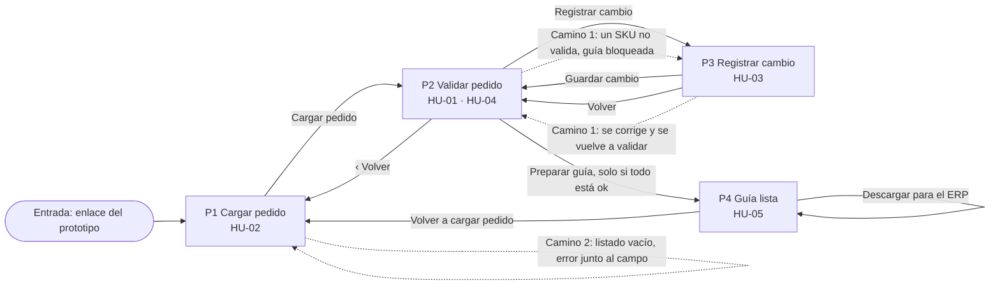

# Prototipo navegable · Avance 5, Parte A

Grupo 6 · Automatizacion_bodega

Prototipo de fidelidad media del flujo principal: cargar el pedido, validarlo contra el inventario, corregir un equipo a último minuto y dejar la guía lista para el ERP. Se puede recorrer sin iniciar sesión. Todo lo que se guarda, descarga o firma usa datos de ejemplo; lo que se quiere observar (navegación, validación de campos y estados) funciona de verdad.

Es un artefacto independiente: vive en [`prototipo/`](../prototipo/) y no usa la aplicación.

## Enlace

**[https://bodega-prototipo.vercel.app](https://bodega-prototipo.vercel.app)**

Se publica en Vercel desde la carpeta `prototipo/` (sitio estático, sin paso de build) y se abre sin iniciar sesión.

### Cómo abrirlo en el computador

- Abrir `prototipo/index.html` con doble clic. No necesita servidor ni instalar nada.
- O, desde la raíz del repositorio: `py -m http.server 8000 --directory prototipo` y entrar a `http://localhost:8000`.

## Sistema mínimo

| Elemento | Valor |
|---|---|
| Tamaños de texto | **16 px** para todo el texto y **24 px** para el título de cada pantalla. El énfasis se hace con el peso (negrita), no con otros tamaños |
| Color de acción | Verde oscuro `#0B4F2E`. Botón principal, enlaces y también el estado "ok" |
| Color de alerta | Rojo `#B42323`. Errores y bloqueos |
| Neutros | Texto `#0F2540`, apoyo `#4A586B`, fondo `#F3F6FB`, bordes `#6B7A8F` |
| Unidad de espaciado | **8 px**. Todo margen, relleno y separación es múltiplo de 8 |
| Tamaño táctil | Todo control mide al menos 44 × 44 px (el mínimo exigido es 24 × 24) |
| Estado | Siempre con texto e ícono además del color: "✓ ok", "✕ no existe", "✕ sin stock", "Pendiente" |

Los contrastes de texto se midieron con un script en las cuatro pantallas y sus estados (móvil 360 × 800 y escritorio): todos superan 4.5:1.

## Mapa de navegación

Líneas continuas: ruta principal y retornos. Líneas punteadas: los dos caminos alternativos.

## Caminos alternativos que se pueden recorrer

**Camino 1 · un SKU no valida (criterio de la HU-01)**

1. En P1, elegir la orden **3002** y presionar *Cargar pedido*.
2. En P2, presionar *Validar*: `SD-63A20-9999` aparece en rojo con "✕ no existe", el mensaje "Corrige 1 producto para continuar" y *Preparar guía* queda bloqueado. Escribir `#/p4` en la barra de direcciones tampoco deja saltarse el bloqueo.
3. Presionar *Registrar cambio* (P3). El equipo que sale y el motivo vienen precargados. Elegir en *Equipo que entra* `SD-63A20-0315` y presionar *Guardar cambio*.
4. De vuelta en P2, la línea nueva queda destacada con quién y a qué hora la cambió. Presionar *Validar*: todo en "✓ ok" y *Preparar guía* se habilita.
5. Variante: si en el paso 3 se elige `SD-63A20-0316` (en mantención), la validación la marca "✕ sin stock" y la guía sigue bloqueada hasta cambiarla de nuevo.

**Camino 2 · campo vacío en la carga**

1. En P1, borrar el listado y presionar *Cargar pedido*.
2. Aparece el error junto al campo: "Pega al menos un SKU, uno por línea". No avanza.
3. Al escribir un SKU el error desaparece y se puede cargar. Con más de 60 productos el error dice cuántos quitar.

## Registro de decisiones

Una fila por pantalla. Los criterios de HU-02 a HU-05 son un **BORRADOR** para que el equipo los revise (ver más abajo); solo la HU-01 tiene criterios aprobados en `docs/historias.md`.

| Pantalla | Historia que resuelve | Criterio que verifica | Funcional | Simulado |
|---|---|---|---|---|
| **P1 Cargar pedido** | HU-02 | Borrador HU-02: con 1 a 60 productos avanza; con listado vacío o excedido muestra el error junto al campo y no avanza | Contador en vivo, límite de 60, error de campo vacío o excedido, SKU en mayúsculas y sin repetidos, precarga al cambiar de orden, *Cancelar* | Que *Cargar pedido* "guarda" la orden: solo la deja en memoria durante la visita |
| **P2 Validar pedido** | HU-01 (principal), HU-04 | **HU-01 principal:** todos ok en verde y *Preparar guía* habilitado. **HU-01 alternativo:** SKU en rojo con motivo "no existe", mensaje "Corrige 1 producto para continuar" y *Preparar guía* bloqueado. Borrador HU-04: la línea cambiada se destaca con quién y a qué hora | Validación real de cada SKU contra el inventario de ejemplo, estados pendiente, validando, ok y error, bloqueo de *Preparar guía* (también por la dirección), destacado del cambio, *Volver* | La espera de 600 ms al validar; el inventario es ficticio |
| **P3 Registrar cambio** | HU-03 | Borrador HU-03: con equipo que sale y que entra, guarda y vuelve a la validación con la línea destacada; si falta uno, o es igual o ya está en el pedido, muestra el error junto al campo y no guarda | Validación de campos con error junto a cada uno, motivo y responsable por opciones, hora tomada del reloj, el cambio modifica la línea de P2 | Que *Guardar cambio* "registra": queda en memoria; no hay inicio de sesión, el responsable se elige de la lista |
| **P4 Guía lista** | HU-05 | Borrador HU-05: con todo ok muestra la guía solo con las líneas vigentes y "Lista para pasar al ERP"; si algún producto no validó, no se llega aquí | Solo las líneas vigentes, descarga de un archivo de texto generado en el navegador, espera al descargar, *Volver a cargar pedido* | El contenido de la guía y el archivo (`.txt` de ejemplo, sin número de guía ni valor legal) |

### Ayudas simuladas

- La frase "Datos de ejemplo: edita el listado para probar un error" bajo el título de P1 y el pie "Prototipo con datos de ejemplo" son ayuda para quien recorre el prototipo. No forman parte del flujo.
- El enlace **Reiniciar demo** del pie vuelve todo al estado inicial (orden 3001, listado original, sin cambios). Es una ayuda simulada: no tiene equivalente en el flujo real.

## Estados visibles

| Estado | Dónde se ve | Cómo se expresa |
|---|---|---|
| Vacío | P1 con el listado vacío (también tras *Cancelar*) y P2 antes de validar | "0 productos detectados · máximo 60" y "Carga cancelada. No se guardó nada."; en P2, "Pendiente" en cada línea y "N productos sin validar" |
| Cargando | Al cargar el pedido (P1), validar (P2), guardar el cambio (P3) y descargar (P4) | Botón desactivado con texto "Cargando…", "Validando…", "Guardando…" o "Preparando archivo…" y un indicador giratorio |
| Error | P1 (listado vacío o excedido), P2 (SKU que no existe o sin stock), P3 (campos sin elegir) | Mensaje en rojo con "✕" junto al campo o a la línea, que dice cómo corregirlo |
| Con datos | P1 con productos detectados, P2 con resultados, P4 con la guía | "✓ 4 de 4 productos ok", "✓ Lista para pasar al ERP"; cada cifra va en texto y no en gráfico |

## Datos de ejemplo (todos ficticios)

Los nombres de los campos son los de [`docs/datos/estructura_datos.md`](datos/estructura_datos.md).

| Pantalla | Campo | Tabla de origen |
|---|---|---|
| P1 | Orden (`id_orden`), Cliente (`id_cliente`), Tipo de movimiento (`tipo_movimiento`), Modalidad (`modalidad`), Productos (`sku_informado`) | ORDENES, DETALLE_ORDEN |
| P2 | Resultado de cada producto (`resultado_validacion`), descripción (`descripcion`), línea vigente (`vigente`), quién y cuándo cambió (`id_usuario`, `fecha_hora_cambio`) | DETALLE_ORDEN, EQUIPOS, REGISTRO_CAMBIOS |
| P3 | Equipo que sale (`id_equipo_sale`), equipo que entra (`id_equipo_entra`), Motivo (`motivo_cambio`), Quién lo registra (`id_usuario`), fecha y hora (`fecha_hora_cambio`) | REGISTRO_CAMBIOS |
| P4 | Líneas con `vigente = sí`, quién la prepara (`id_usuario_emite`), cuándo (`fecha_emision`), archivo (`archivo_pdf`) | DETALLE_ORDEN, GUIAS |

- **Órdenes:** 3001, despacho convencional para Constructora Andes SpA, con 4 productos que validan. 3002, retiro alternativo para Minera Cordillera S.A., con `SD-63A20-9999`, que no existe.
- **Equipos:** `SD-63A20-0314`, `SD-63A20-0315`, `SD-32A10-0102`, `SD-32A10-0108`, `ST-0042` y `MP-0107` están disponibles. `SD-63A20-0316` está en mantención (sin stock).
- **Usuarios:** Pedro Soto (jefe de bodega), que prepara la guía, y Camila Rojas (mantenimiento), precargada como quien registra el cambio.

## Diferencias con los wireframes y con otros documentos

| Tema | Wireframes o documentos | Prototipo |
|---|---|---|
| Quién cambia el equipo | P2b dice "Pedro (mantenimiento)"; P4 dice "Preparada por Oscar" | Se sigue `estructura_datos.md`: Camila Rojas es de mantenimiento y Pedro Soto es jefe de bodega, quien prepara la guía |
| Equipo `SD-63A20-0315` | P2a lo muestra "ok"; `estructura_datos.md` lo tiene en mantención | Disponible. El equipo en mantención del prototipo es `SD-63A20-0316` |
| Orden 3001 | P2a dice que no tiene cambios; el ejemplo de `estructura_datos.md` le registra uno | Sin cambios, como en P2a |
| Límite de productos | Wireframe P1 e historia HU-02: máximo 60 | **60**. La aplicación actual todavía tiene el límite en 50 |
| Orden y cliente en P1 | El wireframe los muestra como campos | Selector de orden con 3001 por defecto; el cliente se precarga y es de solo lectura |
| Retorno en P2 | El wireframe de P2 no tiene botón de retorno | Se agrega "‹ Volver" (lleva a P1), porque el enunciado pide retorno visible en todas las pantallas |
| *Cancelar* de P1 | Dice "vuelve al inicio", y no hay pantalla de inicio | Limpia el formulario y muestra "Carga cancelada. No se guardó nada." |
| Acción primaria | Los wireframes dibujan siempre *Preparar guía* o *Guardar cambio* como botón dominante | Hay un solo botón dominante por pantalla y cambia con el estado: *Validar* antes de validar, *Registrar cambio* si hay un error y *Preparar guía* cuando todo está ok |
| SKU que no existe | `id_equipo_sale` es una clave a EQUIPOS, y un SKU inexistente no tiene equipo | "Equipo que sale" es la línea del pedido tal como se informó |
| Motivo de la orden | `ORDENES.motivo` existe en el modelo; el wireframe P1 no lo muestra | No se incluye, como en el wireframe |
| Número de guía | `GUIAS.numero_guia` es obligatorio; el wireframe P4 no lo muestra | No se muestra; la guía oficial se emite en el ERP |
| Fecha y hora | P3 muestra 09:55 de ejemplo | Se toma del reloj del dispositivo al guardar |
| Archivo de la guía | `archivo_pdf` | Archivo de texto generado en el navegador, marcado como ejemplo |

## Criterios de aceptación en BORRADOR (HU-02 a HU-05)

Propuesta para que el equipo la revise antes de pasarla a `docs/historias.md`. Hoy solo la HU-01 tiene criterios.

- **HU-02**
  - *Principal:* dado que el jefe de bodega pegó un listado de entre 1 y 60 productos, cuando presiona "Cargar pedido", entonces ve "N productos detectados" y pasa a validar el pedido.
  - *Alternativo:* dado que el listado está vacío o tiene más de 60, cuando presiona "Cargar pedido", entonces ve junto al campo cómo corregirlo y no avanza.
- **HU-03**
  - *Principal:* dado que elige el equipo que sale y el que entra, cuando presiona "Guardar cambio", entonces vuelve a la validación con esa línea destacada, con quién y a qué hora.
  - *Alternativo:* dado que falta el equipo que entra, o es igual al que sale o ya está en el pedido, cuando presiona "Guardar cambio", entonces ve el error junto al campo y no se guarda nada.
- **HU-04**
  - *Principal:* dado que hay un cambio registrado, cuando el jefe de bodega ve la validación, entonces la línea cambiada sale destacada con "Cambiado por X a las HH:MM", y la línea anterior se conserva como no vigente.
  - *Alternativo:* dado que la orden no tiene cambios, entonces ninguna línea sale destacada.
- **HU-05**
  - *Principal:* dado que todos los productos están ok, cuando presiona "Preparar guía", entonces ve la guía solo con las líneas vigentes y "Lista para pasar al ERP".
  - *Alternativo:* dado que algún producto no validó, entonces "Preparar guía" está bloqueado y no se llega a la guía.

## Cómo se verificó

Recorrido automatizado con un navegador real (Chrome) a 360 × 800 y a 1280 × 800: ruta principal completa con descarga, retorno desde las cuatro pantallas y con el botón Atrás del navegador, los dos caminos alternativos de punta a punta, validación de campo vacío, de más de 60 productos y de SKU inválido, los cuatro estados, bloqueo por la dirección, y una auditoría de contraste, tamaño táctil, tamaños de texto, múltiplos de 8 px, etiquetas visibles y ausencia de desborde horizontal.
